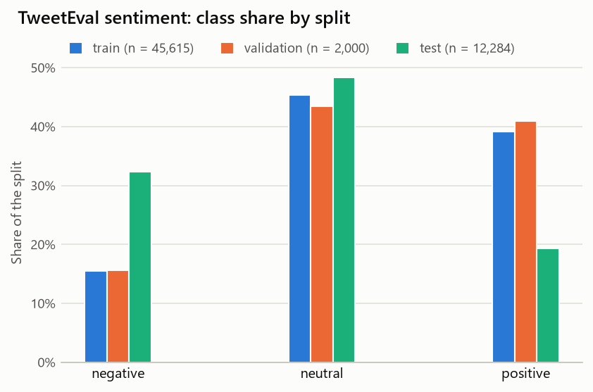
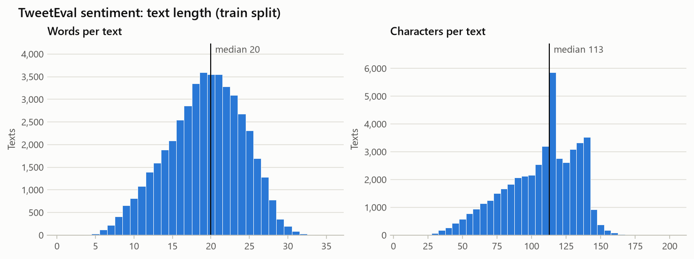
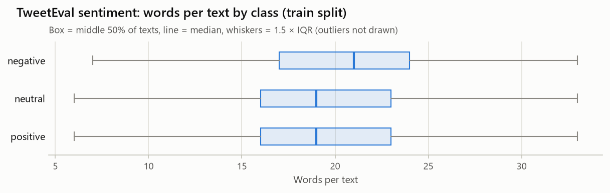
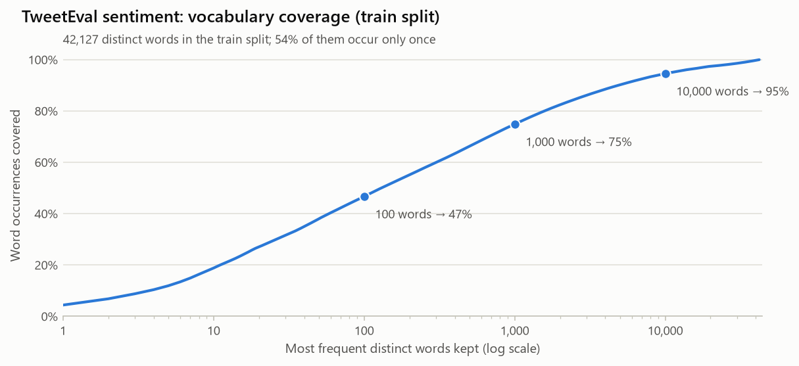
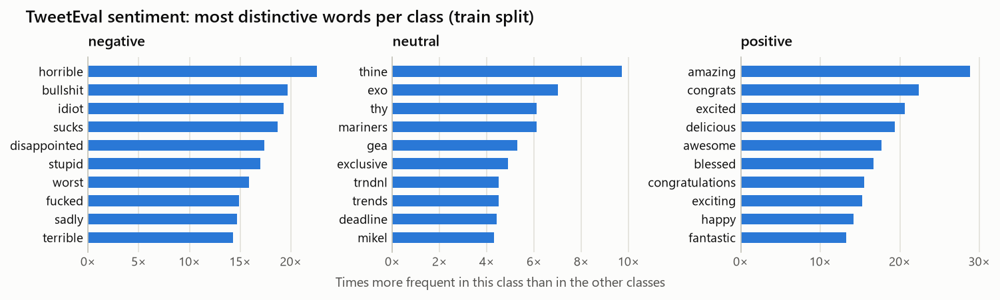
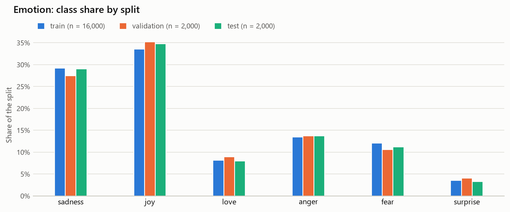
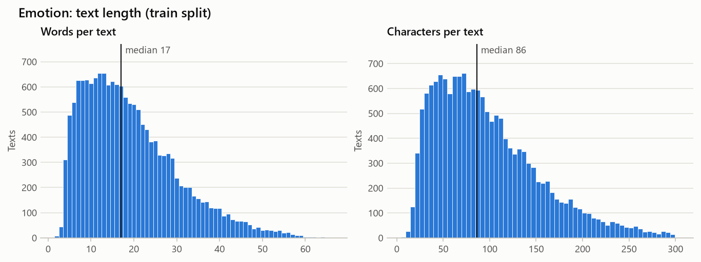
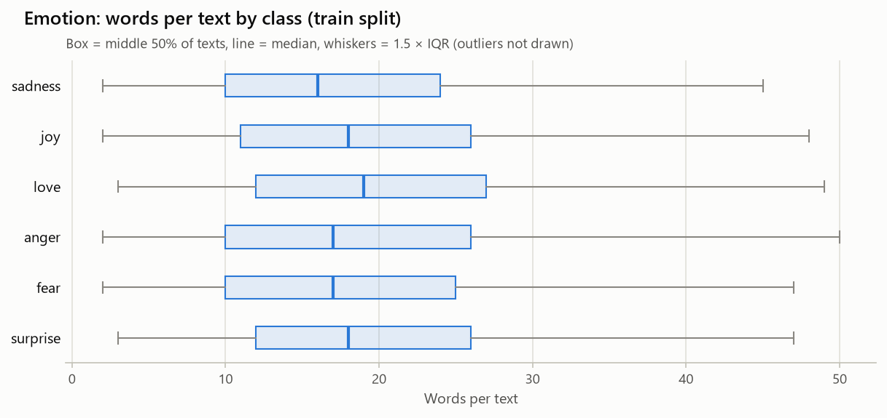
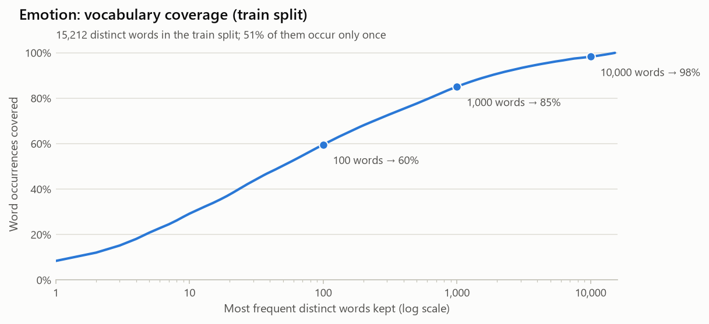
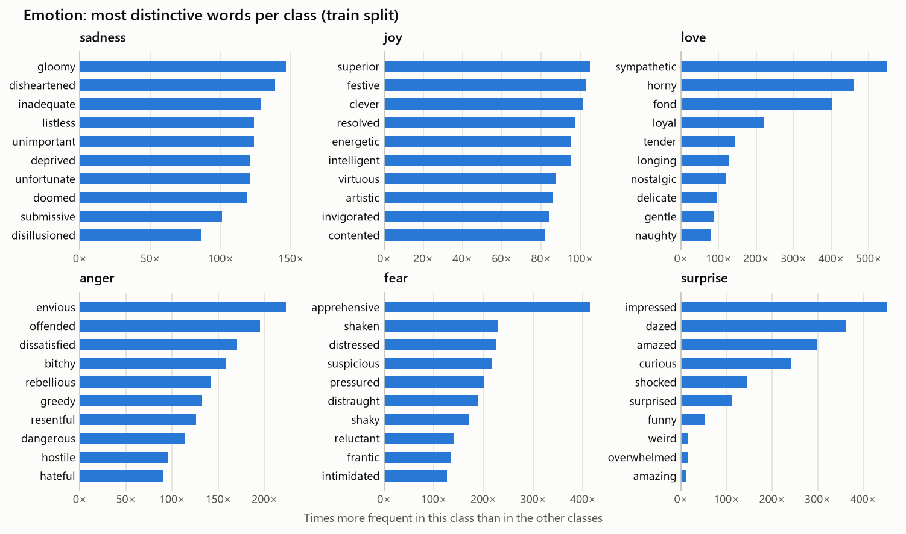

# Dataset Summary

_Phase 1 of **Sentiment and Emotion Analysis Using Machine Learning**. Generated by `src/make_dataset_summary.py` on 2026-11-03 from the files in `data/raw/`; the figures come from the EDA notebooks._

## At a glance

|  | Task A: Sentiment | Task B: Emotion |
| --- | --- | --- |
| Hugging Face dataset | [cardiffnlp/tweet_eval](https://huggingface.co/datasets/cardiffnlp/tweet_eval), config `sentiment` | [dair-ai/emotion](https://huggingface.co/datasets/dair-ai/emotion), config `split` |
| Pinned revision | `b3a375b` | `cab853a` |
| Classes | 3: negative, neutral, positive | 6: sadness, joy, love, anger, fear, surprise |
| Train / validation / test | 45,615 / 2,000 / 12,284 | 16,000 / 2,000 / 2,000 |
| Largest : smallest class (train) | 2.9 : 1 (neutral : negative) | 9.4 : 1 (joy : surprise) |
| Train vs test class shift (total variation) | 19.8 points | 1.5 points |
| Median words per text (train) | 20 | 17 |
| Distinct words (train) | 42,127 | 15,212 |
| Words covering 95% of tokens (train) | 10,887 | 4,179 |
| Repeated texts / texts with conflicting labels (train) | 29 / 3 | 31 / 30 |
| Distinct texts found in more than one split | 0 | 19 |
| Texts with uppercase / `!` or `?` / `@user` / hashtag | 98% / 30% / 29% / 19% | 0% / 0% / 0% / 0% |
| License | CC BY 3.0 (SemEval-2017 data); use must also comply with the Twitter/X Terms of Service | Educational and research use only (per the dataset card) |

## Task A: Sentiment analysis (TweetEval)

- **Source:** [cardiffnlp/tweet_eval](https://huggingface.co/datasets/cardiffnlp/tweet_eval), config `sentiment`, revision `b3a375b`
- **Origin:** English tweets from SemEval-2017 Task 4 (subtask A), packaged by the TweetEval benchmark. User names are replaced with `@user`. TweetEval's official metric for this task is macro-averaged recall.
- **License:** CC BY 3.0 (SemEval-2017 data); use must also comply with the Twitter/X Terms of Service
- **Notebook:** [`notebooks/sentiment_eda.ipynb`](../notebooks/sentiment_eda.ipynb)

### Class distribution

| Class (label id) | Train | Validation | Test |
| --- | ---: | ---: | ---: |
| negative (0) | 7,093 (15.5%) | 312 (15.6%) | 3,972 (32.3%) |
| neutral (1) | 20,673 (45.3%) | 869 (43.4%) | 5,937 (48.3%) |
| positive (2) | 17,849 (39.1%) | 819 (40.9%) | 2,375 (19.3%) |
| **Total** | **45,615** | **2,000** | **12,284** |

### Data quality

| Split | Rows | Empty texts | Repeated texts | Texts with conflicting labels |
| --- | ---: | ---: | ---: | ---: |
| train | 45,615 | 0 | 29 | 3 |
| validation | 2,000 | 0 | 0 | 0 |
| test | 12,284 | 0 | 0 | 0 |

Texts shared between splits: train & validation: 0, train & test: 0, validation & test: 0.

### Text length (train)

|  | Mean | Median | 95th percentile | Max |
| --- | ---: | ---: | ---: | ---: |
| Words | 19.2 | 20 | 27 | 35 |
| Characters | 106.9 | 113 | 141 | 200 |

Median words per class: negative 21, neutral 19, positive 19.

### Text features (% of train texts)

| Feature | negative | neutral | positive | all |
| --- | ---: | ---: | ---: | ---: |
| @user mention | 28.0 | 27.9 | 30.2 | 28.8 |
| hashtag | 15.0 | 18.7 | 20.2 | 18.7 |
| URL or http | 0.3 | 0.2 | 0.1 | 0.2 |
| HTML entity (e.g. &amp;amp;) | 4.1 | 4.0 | 4.5 | 4.2 |
| escaped character (e.g. \u2019) | 13.2 | 11.2 | 10.4 | 11.2 |
| number | 35.9 | 46.1 | 41.7 | 42.8 |
| uppercase letter | 97.8 | 98.2 | 98.1 | 98.1 |
| ! or ? | 23.9 | 24.9 | 38.6 | 30.1 |
| apostrophe | 36.8 | 28.4 | 31.3 | 30.8 |
| feel (any form) | 1.7 | 0.9 | 1.0 | 1.0 |

### Vocabulary (train)

- Word tokens: 860,817
- Distinct words: 42,127 (22,949 seen only once)
- Words needed to cover 90% / 95% of tokens: 4,862 / 10,887

### Most distinctive words per class (train)

Ratio = how many times more frequent the word is in the class than in the other classes (stop words removed; words used at least 25 times).

| Class | Top words (ratio) |
| --- | --- |
| negative | horrible (23×), bullshit (20×), idiot (19×), sucks (19×), disappointed (17×), stupid (17×) |
| neutral | thine (10×), exo (7×), thy (6×), mariners (6×), gea (5×), exclusive (5×) |
| positive | amazing (29×), congrats (22×), excited (21×), delicious (19×), awesome (18×), blessed (17×) |

### Observations

- **Imbalanced classes.** `neutral` is the largest class (45.3% of train) and `negative` the smallest (15.5%), a 2.9 : 1 ratio.
- **The test split has a different class mix.** `negative` rises from 15.5% of train to 32.3% of test, while `positive` falls from 39.1% to 19.3% (total variation distance 19.8 points, against 1.9 between train and validation). Validation results will not reflect the test class mix, so accuracy alone would be misleading.
- **Data quality.** No empty texts. Train contains 29 repeated copies of texts, and 3 distinct texts appear with more than one label; no text occurs in more than one split.
- **Short texts.** Median 20 words (113 characters); 95% of texts have at most 27 words (longest 35). Median length per class only ranges from 19 to 21 words, so length alone carries little class signal.
- **Raw tweet text.** 98% of texts contain uppercase letters, 29% an `@user` mention, 19% a hashtag and 4% an HTML entity such as `&amp;`; URLs are almost absent (0.2%). `!` or `?` appears in 38.6% of `positive` texts but only 23.9% of `negative` texts.
- **Train and test are formatted differently.** 11.2% of train and 10.3% of validation texts contain literal escape sequences such as `\u2019` (’) and `\u002c` (,), against 0.0% of test texts. Left as they are, a bag-of-words model would learn junk tokens such as `u2019t` and `u002c` that never occur at test time.
- **Vocabulary.** 42,127 distinct words in train, 54% of them seen only once; the 10,887 most frequent words cover 95% of all word occurrences.
- **Indicative words.** The most distinctive words per class are `negative`: horrible, bullshit, idiot; `neutral`: thine, exo, thy; `positive`: amazing, congrats, excited. `neutral` has no strongly indicative words (its strongest is only 9.7× more frequent than in the other classes, against 22.6×–28.8× for the rest), so it is likely to be the hardest class to separate.

### Figures











## Task B: Emotion detection (dair-ai Emotion)

- **Source:** [dair-ai/emotion](https://huggingface.co/datasets/dair-ai/emotion), config `split`, revision `cab853a`
- **Origin:** English Twitter messages labelled with six basic emotions, from the CARER paper (Saravia et al., 2018). The texts are distributed already lowercased, with punctuation, digits, hashtags and mentions removed.
- **License:** Educational and research use only (per the dataset card)
- **Notebook:** [`notebooks/emotion_eda.ipynb`](../notebooks/emotion_eda.ipynb)

### Class distribution

| Class (label id) | Train | Validation | Test |
| --- | ---: | ---: | ---: |
| sadness (0) | 4,666 (29.2%) | 550 (27.5%) | 581 (29.0%) |
| joy (1) | 5,362 (33.5%) | 704 (35.2%) | 695 (34.8%) |
| love (2) | 1,304 (8.2%) | 178 (8.9%) | 159 (8.0%) |
| anger (3) | 2,159 (13.5%) | 275 (13.8%) | 275 (13.8%) |
| fear (4) | 1,937 (12.1%) | 212 (10.6%) | 224 (11.2%) |
| surprise (5) | 572 (3.6%) | 81 (4.0%) | 66 (3.3%) |
| **Total** | **16,000** | **2,000** | **2,000** |

### Data quality

| Split | Rows | Empty texts | Repeated texts | Texts with conflicting labels |
| --- | ---: | ---: | ---: | ---: |
| train | 16,000 | 0 | 31 | 30 |
| validation | 2,000 | 0 | 2 | 2 |
| test | 2,000 | 0 | 0 | 0 |

Texts shared between splits: train & validation: 5, train & test: 11, validation & test: 3.

### Text length (train)

|  | Mean | Median | 95th percentile | Max |
| --- | ---: | ---: | ---: | ---: |
| Words | 19.2 | 17 | 41 | 66 |
| Characters | 96.8 | 86 | 207 | 300 |

Median words per class: sadness 16, joy 18, love 19, anger 17, fear 17, surprise 18.

### Text features (% of train texts)

| Feature | sadness | joy | love | anger | fear | surprise | all |
| --- | ---: | ---: | ---: | ---: | ---: | ---: | ---: |
| @user mention | 0.0 | 0.0 | 0.0 | 0.0 | 0.0 | 0.0 | 0.0 |
| hashtag | 0.0 | 0.0 | 0.0 | 0.0 | 0.0 | 0.0 | 0.0 |
| URL or http | 1.4 | 1.5 | 1.7 | 0.7 | 0.4 | 1.4 | 1.2 |
| HTML entity (e.g. &amp;amp;) | 0.0 | 0.0 | 0.0 | 0.0 | 0.0 | 0.0 | 0.0 |
| escaped character (e.g. \u2019) | 0.0 | 0.0 | 0.0 | 0.0 | 0.0 | 0.0 | 0.0 |
| number | 0.0 | 0.0 | 0.0 | 0.0 | 0.0 | 0.0 | 0.0 |
| uppercase letter | 0.0 | 0.0 | 0.0 | 0.0 | 0.0 | 0.0 | 0.0 |
| ! or ? | 0.0 | 0.0 | 0.0 | 0.0 | 0.0 | 0.0 | 0.0 |
| apostrophe | 0.0 | 0.0 | 0.0 | 0.0 | 0.0 | 0.0 | 0.0 |
| feel (any form) | 99.3 | 99.2 | 100.0 | 96.2 | 97.5 | 100.0 | 98.7 |

### Vocabulary (train)

- Word tokens: 306,661
- Distinct words: 15,212 (7,813 seen only once)
- Words needed to cover 90% / 95% of tokens: 1,782 / 4,179

### Most distinctive words per class (train)

Ratio = how many times more frequent the word is in the class than in the other classes (stop words removed; words used at least 25 times).

| Class | Top words (ratio) |
| --- | --- |
| sadness | gloomy (146×), disheartened (139×), inadequate (129×), listless (124×), unimportant (124×), deprived (121×) |
| joy | superior (105×), festive (103×), clever (101×), resolved (97×), energetic (96×), intelligent (96×) |
| love | sympathetic (548×), horny (460×), fond (401×), loyal (220×), tender (144×), longing (127×) |
| anger | envious (223×), offended (195×), dissatisfied (170×), bitchy (158×), rebellious (142×), greedy (132×) |
| fear | apprehensive (414×), shaken (228×), distressed (225×), suspicious (218×), pressured (200×), distraught (190×) |
| surprise | impressed (452×), dazed (361×), amazed (298×), curious (241×), shocked (144×), surprised (111×) |

### Observations

- **Imbalanced classes.** `joy` is the largest class (33.5% of train) and `surprise` the smallest (3.6%), a 9.4 : 1 ratio.
- **Consistent splits.** Class shares differ by only 1.5 points between train and test, and 3.2 between train and validation.
- **Data quality.** No empty texts. Train contains 31 repeated copies of texts, and 30 distinct texts appear with more than one label; 19 distinct texts occur in more than one split (possible leakage).
- **Short texts.** Median 17 words (86 characters); 95% of texts have at most 41 words (longest 66). Median length per class only ranges from 16 to 19 words, so length alone carries little class signal.
- **Pre-cleaned text.** No train text contains uppercase letters, numbers, `!` or `?`, apostrophes, hashtags or `@user` mentions. 98.7% of texts contain a form of 'feel', so 'feel' and 'feeling' carry no class information.
- **Vocabulary.** 15,212 distinct words in train, 51% of them seen only once; the 4,179 most frequent words cover 95% of all word occurrences.
- **Indicative words.** Every class has words that occur almost only in that class (strongest ratios 105×–548×), e.g. `sadness`: gloomy, disheartened, inadequate; `joy`: superior, festive, clever; `love`: sympathetic, horny, fond; `anger`: envious, offended, dissatisfied; `fear`: apprehensive, shaken, distressed; `surprise`: impressed, dazed, amazed. A bag-of-words model should separate the classes well, but may lean on these keywords rather than on context.

### Figures











## Implications for Phase 2 (modelling)

- **Splits.** Keep the official train / validation / test splits: tune on validation and evaluate on test once, so results are comparable with published numbers.
- **Metrics.** Report macro-averaged F1 with per-class precision, recall and a confusion matrix (plus macro-averaged recall for TweetEval). Accuracy alone is misleading with imbalanced classes and, for sentiment, a test split whose class mix differs from train (19.8 points).
- **Class imbalance.** Compare `LogisticRegression(class_weight=None)` with `class_weight="balanced"`, watching the smallest classes (`negative` for sentiment, `surprise` for emotion).
- **Cleaning.** Sentiment text is raw: decode the literal `\uXXXX` escape sequences (11% of train texts, 0.0% of test) and HTML entities such as `&amp;`, lowercase it, and treat `@user` as a single token or drop it. `src/eda.py`'s `decode_artifacts()` already does the decoding. The emotion text is already clean.
- **Stop words.** Do not use scikit-learn's built-in English stop-word list for sentiment: it removes negations (not, no, nor, never, nothing, none, cannot). TF-IDF's IDF term already down-weights words that occur in every class (such as 'feel' in the emotion data).
- **Duplicates.** Drop texts with conflicting labels from the training split (3 for sentiment, 30 for emotion); leave validation and test unchanged.
- **TF-IDF starting point.** Word unigrams and bigrams, `min_df=2` (about half of all distinct words occur only once), `sublinear_tf=True`, and `max_features` near the 95%-coverage points (10,887 for sentiment, 4,179 for emotion), then tune on validation.

## Reproducing this report

```powershell
python src/download_data.py
jupyter nbconvert --to notebook --execute --inplace notebooks/sentiment_eda.ipynb notebooks/emotion_eda.ipynb
python src/make_dataset_summary.py
```

## Sources

- Barbieri, F., Camacho-Collados, J., Espinosa-Anke, L. and Neves, L. (2020). *TweetEval: Unified Benchmark and Comparative Evaluation for Tweet Classification.* Findings of EMNLP 2020.
- Rosenthal, S., Farra, N. and Nakov, P. (2017). *SemEval-2017 Task 4: Sentiment Analysis in Twitter.* Proceedings of SemEval-2017, pp. 502-518.
- Saravia, E., Liu, H.-C. T., Huang, Y.-H., Wu, J. and Chen, Y.-S. (2018). *CARER: Contextualized Affect Representations for Emotion Recognition.* Proceedings of EMNLP 2018, pp. 3687-3697.
