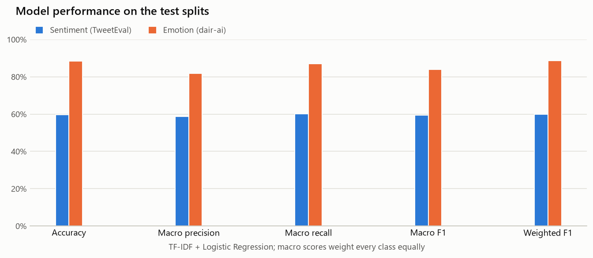
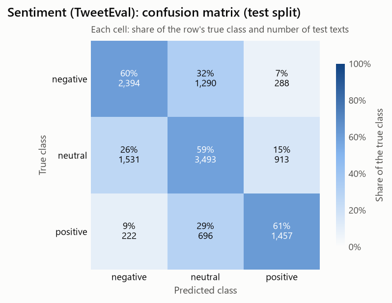
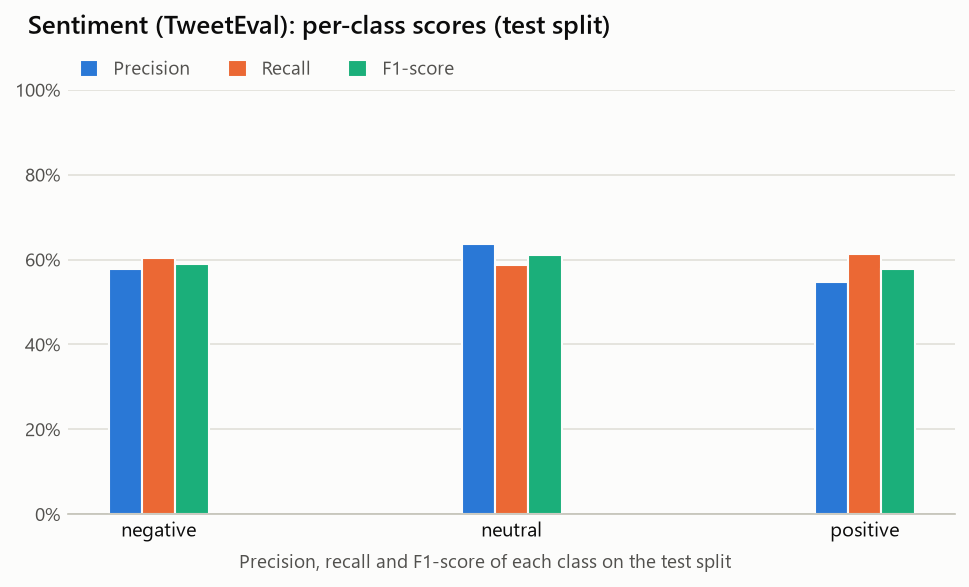
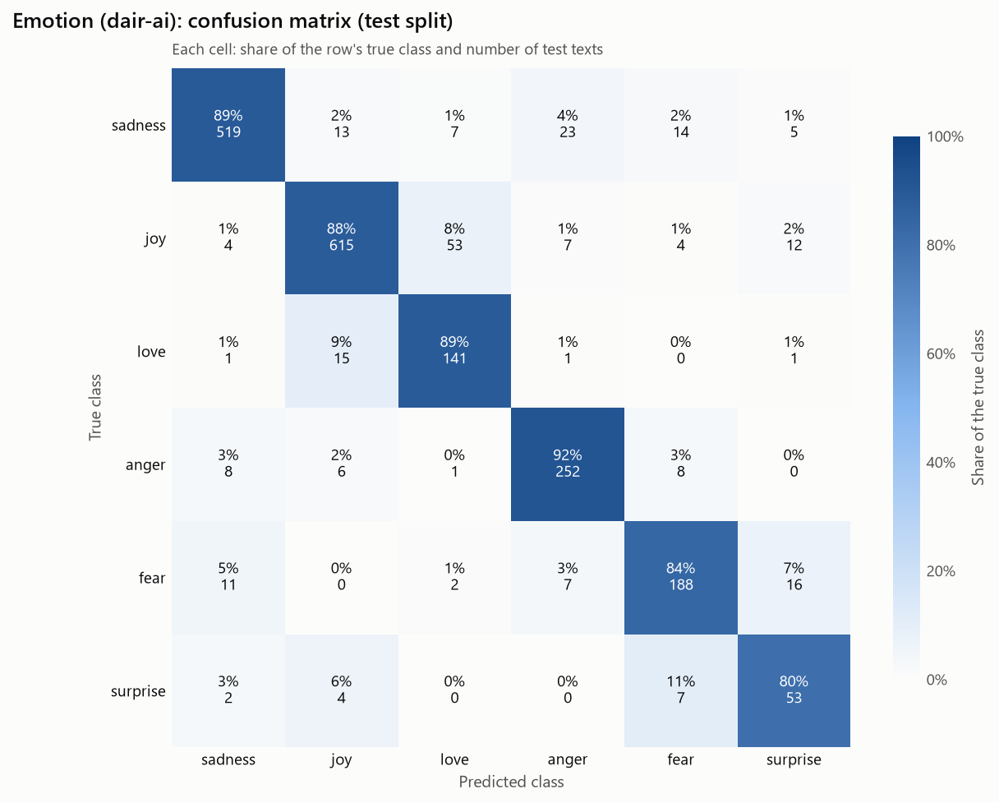
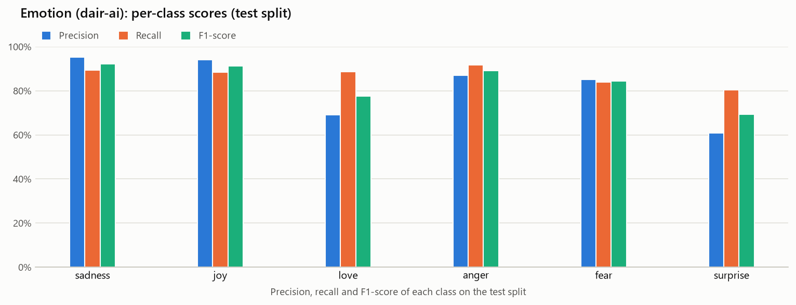

# Model Evaluation

_Phase 2 of **Sentiment and Emotion Analysis Using Machine Learning**. Generated by `src/evaluate.py` from the saved models; every number below comes from running them on the data._

## Method

- **Data:** the Phase 1 datasets at their pinned revisions and official splits. `src/prepare_data.py` removes training texts with conflicting labels and keeps one copy of exact duplicates; validation and test are used unchanged.
- **Preprocessing** (`src/preprocessing.py`, built into each saved vectorizer so training and prediction match): decode escape sequences and HTML entities (Phase 1's `decode_artifacts`), lowercase, replace URLs and @mentions with placeholder words, strip `#` from hashtags, spell negations out as `not`. No stop-word list, so *not*, *no* and *never* are kept; `!`, `?` and emoticons are kept as tokens.
- **Features:** TF-IDF with sublinear term frequency, fitted on the training split only. Configurations tried: `unigrams`, `uni+bigrams, 20k`, `uni+bigrams, 50k`, `uni+bigrams, all` (all with min_df=2, max_df=0.95).
- **Classifier:** Logistic Regression (lbfgs, max_iter=3000, random_state=42) with C in [0.25, 0.5, 1.0, 2.0, 4.0, 8.0, 16.0] and class_weight None or "balanced".
- **Selection:** the candidate with the highest **validation macro F1** was refitted on the training split. The test split was used once, for the results below.

## Results at a glance (test splits)

| Metric | Sentiment (TweetEval) | Emotion (dair-ai) |
| --- | ---: | ---: |
| Accuracy | 59.8% | 88.4% |
| Macro precision | 58.8% | 81.9% |
| Macro recall | 60.2% | 87.1% |
| Macro F1 | 59.4% | 84.0% |
| Weighted F1 | 59.8% | 88.7% |

## Sentiment (TweetEval)

**Selected model:** TF-IDF `uni+bigrams, all` (n-grams (1, 2), min_df=2, max_df=0.95, 95,413 features, sublinear TF) + Logistic Regression (C=4.0, class_weight=balanced, solver=lbfgs). Trained on 45,583 texts; evaluated on 12,284 test texts.

| Metric | Validation | Test |
| --- | ---: | ---: |
| Accuracy | 68.7% | 59.8% |
| Macro precision |  | 58.8% |
| Macro recall |  | 60.2% |
| **Macro F1** | **66.6%** | **59.4%** |
| Weighted F1 | 68.9% | 59.8% |

### Per-class results (test)

| Class | Precision | Recall | F1-score | Support |
| --- | ---: | ---: | ---: | ---: |
| negative | 57.7% | 60.3% | 59.0% | 3,972 |
| neutral | 63.8% | 58.8% | 61.2% | 5,937 |
| positive | 54.8% | 61.3% | 57.9% | 2,375 |

### Confusion matrix (test; rows = true class, columns = predicted class)

| True \ Predicted | negative | neutral | positive |
| --- | ---: | ---: | ---: |
| negative | 2,394 | 1,290 | 288 |
| neutral | 1,531 | 3,493 | 913 |
| positive | 222 | 696 | 1,457 |

### Observations

- Test macro F1 is 59.4% against 66.6% on validation (-7.3 points).
- Balanced class weights won model selection: best validation macro F1 66.6% balanced vs 65.5% unweighted.
- Best class: `neutral` (F1 61.2%); weakest: `positive` (F1 57.9%, recall 61.3%).
- Most frequent confusions: `negative` predicted as `neutral` 32% of the time (1,290 texts); `positive` predicted as `neutral` 29% of the time (696 texts); `neutral` predicted as `negative` 26% of the time (1,531 texts).
- Phase 1 found that the test split has twice the share of negative tweets as train (32.3% vs 15.5%) and that `neutral` has no strong cue words; the confusion matrix shows where this costs accuracy. Macro recall is TweetEval's official metric for this task.

## Emotion (dair-ai)

**Selected model:** TF-IDF `unigrams` (n-grams (1, 1), min_df=2, max_df=0.95, 7,219 features, sublinear TF) + Logistic Regression (C=4.0, class_weight=balanced, solver=lbfgs). Trained on 15,939 texts; evaluated on 2,000 test texts.

| Metric | Validation | Test |
| --- | ---: | ---: |
| Accuracy | 89.8% | 88.4% |
| Macro precision |  | 81.9% |
| Macro recall |  | 87.1% |
| **Macro F1** | **87.7%** | **84.0%** |
| Weighted F1 | 90.0% | 88.7% |

### Per-class results (test)

| Class | Precision | Recall | F1-score | Support |
| --- | ---: | ---: | ---: | ---: |
| sadness | 95.2% | 89.3% | 92.2% | 581 |
| joy | 94.2% | 88.5% | 91.2% | 695 |
| love | 69.1% | 88.7% | 77.7% | 159 |
| anger | 86.9% | 91.6% | 89.2% | 275 |
| fear | 85.1% | 83.9% | 84.5% | 224 |
| surprise | 60.9% | 80.3% | 69.3% | 66 |

### Confusion matrix (test; rows = true class, columns = predicted class)

| True \ Predicted | sadness | joy | love | anger | fear | surprise |
| --- | ---: | ---: | ---: | ---: | ---: | ---: |
| sadness | 519 | 13 | 7 | 23 | 14 | 5 |
| joy | 4 | 615 | 53 | 7 | 4 | 12 |
| love | 1 | 15 | 141 | 1 | 0 | 1 |
| anger | 8 | 6 | 1 | 252 | 8 | 0 |
| fear | 11 | 0 | 2 | 7 | 188 | 16 |
| surprise | 2 | 4 | 0 | 0 | 7 | 53 |

### Observations

- Test macro F1 is 84.0% against 87.7% on validation (-3.7 points).
- Balanced class weights won model selection: best validation macro F1 87.7% balanced vs 86.5% unweighted.
- Best class: `sadness` (F1 92.2%); weakest: `surprise` (F1 69.3%, recall 80.3%).
- Most frequent confusions: `surprise` predicted as `fear` 11% of the time (7 texts); `love` predicted as `joy` 9% of the time (15 texts); `joy` predicted as `love` 8% of the time (53 texts).
- Phase 1 found that each emotion has strongly indicative keywords and that the conflicting duplicates were mostly joy/love and fear/surprise, the same pairs that remain hardest here.

## Model selection on validation

### Sentiment (TweetEval): best validation result per configuration

| TF-IDF | Features | class_weight | Best C | Macro F1 | Accuracy |
| --- | ---: | --- | ---: | ---: | ---: |
| uni+bigrams, all | 95,413 | balanced | 4.0 | 66.6% | 68.7% |
| uni+bigrams, 50k | 50,000 | balanced | 2.0 | 65.9% | 68.0% |
| uni+bigrams, 20k | 20,000 | balanced | 4.0 | 65.8% | 67.8% |
| unigrams | 19,018 | none | 4.0 | 65.5% | 68.8% |
| uni+bigrams, all | 95,413 | none | 4.0 | 65.0% | 68.9% |
| uni+bigrams, 20k | 20,000 | none | 2.0 | 65.0% | 68.8% |
| unigrams | 19,018 | balanced | 1.0 | 64.8% | 66.8% |
| uni+bigrams, 50k | 50,000 | none | 16.0 | 64.6% | 67.6% |

All 56 candidates: `reports/metrics/sentiment_validation_results.csv`.

### Emotion (dair-ai): best validation result per configuration

| TF-IDF | Features | class_weight | Best C | Macro F1 | Accuracy |
| --- | ---: | --- | ---: | ---: | ---: |
| unigrams | 7,219 | balanced | 4.0 | 87.7% | 89.8% |
| uni+bigrams, 20k | 20,000 | balanced | 4.0 | 86.6% | 89.5% |
| unigrams | 7,219 | none | 16.0 | 86.5% | 89.5% |
| uni+bigrams, 50k | 32,640 | balanced | 4.0 | 86.0% | 89.0% |
| uni+bigrams, all | 32,640 | balanced | 4.0 | 86.0% | 89.0% |
| uni+bigrams, 20k | 20,000 | none | 16.0 | 84.7% | 88.4% |
| uni+bigrams, 50k | 32,640 | none | 16.0 | 84.7% | 88.5% |
| uni+bigrams, all | 32,640 | none | 16.0 | 84.7% | 88.5% |

All 56 candidates: `reports/metrics/emotion_validation_results.csv`.

## Limitations

- Bag-of-words features ignore word order beyond bigrams, so sarcasm and long-range negation are hard to capture.
- The models only know words seen in training; emoji support exists in the tokenizer, but neither dataset contains emoji, so they carry no learned weight.
- The emotion data was labelled around emotion keywords, so its high scores may not transfer to text that expresses emotion without them.
- Emotion (dair-ai): the best unweighted model sits at the largest C tried (16.0, validation macro F1 86.5%), so a wider grid could narrow its gap to the selected balanced model.
